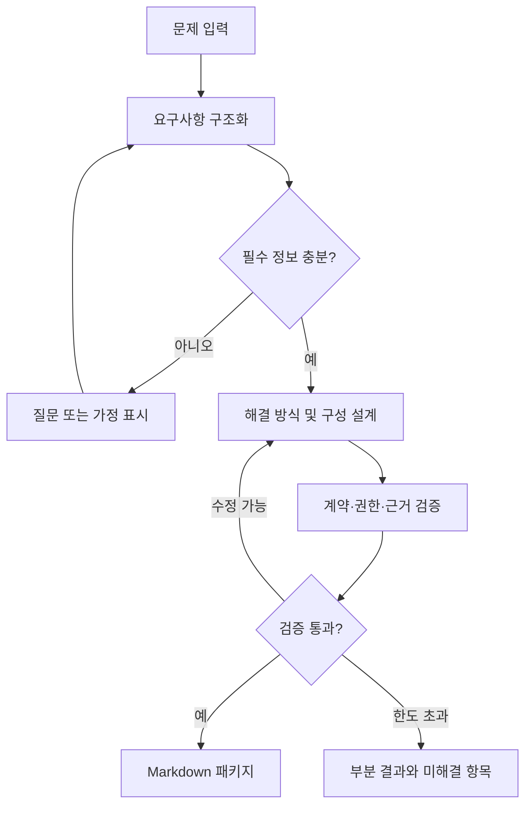

# 02. 시스템 설계

상태: 논리 설계 제안 v0.1 · 구현 및 기술 선정 전

## 생성 시스템과 생성 결과 구분

- **생성 시스템:** 사용자 문제를 분석하고 설계 패키지를 만드는 이 서비스.
- **생성 결과:** 사용자 문제를 해결할 에이전트의 명세, 워크플로와 개발 계획.
- **실행 시스템:** 생성 결과를 실행하는 후속 단계의 런타임. MVP에서는 구현하지 않는다.

역할을 나누는 것과 각각을 독립 에이전트로 구현하는 것은 별개다. 먼저 단일 파이프라인으로 검증하고, 역할 분리가 품질이나 운영에 도움이 될 때 확장한다.

## 논리 흐름

## 논리 역할

| 역할 | 입력 | 출력 | 책임 경계 |
| --- | --- | --- | --- |
| 요구사항 정리 | 원문, 답변 | 목적, 요구사항, 제약, 가정 | 사용자 의도를 임의 확정하지 않음 |
| 구성 설계 | 정리된 요구사항 | 역할, 도구, 의존성, 흐름 | 에이전트 수를 성과로 취급하지 않음 |
| 검증 | 명세와 흐름 | 모순, 누락, 수정 요청 | 문장 품질과 실행 가능성을 구분 |
| 문서 출력 | 검증된 상태 | 문서 묶음, 변경 요약 | 문서마다 다른 사실을 생성하지 않음 |

## 공유 상태 제안

| 필드 | 내용 |
| --- | --- |
| project_id / revision | 프로젝트 식별자와 설계 버전 |
| source / goal / users | 근본 목적, 성공 조건, 사용자 |
| requirements | 요구사항 ID, 내용, 근거, 우선순위 |
| constraints / assumptions / open_questions | 제약, 가정, 미해결 질문 |
| solution_type | 규칙 기반 / 단일 에이전트 / 다중 에이전트와 선택 이유 |
| agents / tools / workflow | 역할, 도구 계약, 실행 흐름 |
| validation_issues / retry_count | 검증 오류와 재시도 횟수 |
| artifacts / change_log | 문서 버전과 변경 이유 |

요구사항에는 원문 근거 또는 가정 여부를 기록한다. 요구사항 ID를 역할·평가 항목·개발 작업에서 참조해 추적 가능하게 한다.

## 생성되는 에이전트 명세

각 명세에 다음 항목을 포함한다.

- ID, 이름, 역할·목적, 담당 요구사항 ID
- 입력·출력 필드와 필수 여부
- 사용 도구, 접근 범위, 읽기·쓰기 권한
- 판단 기준, 금지 행동, 근거 자료
- 의존 역할, 실행 조건, 완료 조건
- 타임아웃, 재시도, 실패 시 대체 동작
- 사람의 검토가 필요한 지점
- 정상·실패 평가 사례

도구 명세에는 연결 상태를 **사용 가능 / 연결 필요 / 미확인**으로 구분한다. 존재하지 않는 API를 사용 가능하다고 가정하지 않는다.

## 사용자에게 제공할 패키지

| 경로 제안 | 내용 |
| --- | --- |
| README.md | 문제, 사용 방법, 현재 한계 |
| requirements.md | 목적, 요구사항, 가정, 미결정 사항 |
| agents.md | 역할별 명세 |
| workflow.md | 분기·실패·검토가 포함된 실행 흐름 |
| tools.md | 도구의 입출력, 권한, 연결 조건 |
| evaluation.md | 요구사항별 평가 사례와 판정 기준 |
| backlog.md | 의존성이 드러나는 개발 작업 순서 |

이 목록은 서비스가 향후 생성할 파일의 계약이다. 현재 저장소의 기획 문서와 구분한다.

## 실패·수정 처리 제안

- 질문은 기본 2회, 회당 최대 3개로 제한한다. 미해결 내용은 가정 또는 보류로 남긴다.
- 출력 형식 오류와 의미상 모순은 구분해 검증한다. 형식 검증 통과를 품질 통과로 보지 않는다.
- 설계 보정은 최대 2회로 시작해 평가 결과로 조정한다. 실패하면 무한 반복하지 않고 원인을 출력한다.
- 변경 요구에는 새 revision을 부여한다. 영향받는 역할·흐름·평가·문서를 함께 재검증한다.
- 생성 결과 안의 명령과 입력 자료는 실행 권한을 부여하지 않는다.
- 비밀키 대신 환경변수 이름을 문서화한다. 외부 쓰기·배포 권한은 실행 단계에서 별도로 다룬다.

## 기술 선택 후보

| 영역 | 후보 | 도입 조건 |
| --- | --- | --- |
| 초기 인터페이스 | CLI 또는 최소 웹 폼 | 설계 입출력 계약을 빠르게 검증 |
| API | Python / FastAPI | 웹 클라이언트 및 실행 상태 조회가 필요할 때 |
| 흐름 관리 | 일반 Python → LangGraph 검토 | 분기·재개·상태 관리가 복잡해질 때 |
| LLM | 호스팅 API, 로컬 모델 어댑터 | 품질·비용·실행 환경을 동일 사례로 비교 |
| 저장 | 파일 → PostgreSQL 검토 | 다중 프로젝트·버전·사용자 관리가 필요할 때 |
| 비동기 작업 | Redis 기반 큐 검토 | 긴 작업, 재시도, 동시 요청 관리가 필요할 때 |
| 환경·배포 | Docker, 이후 클라우드 검토 | 재현 가능한 실행이 필요할 때 |
| 운영 확장 | Kubernetes 검토 | 서비스 분리·확장·운영 요구가 확인될 때 |

제품 공급자, 모델, 라이브러리 버전, 클라우드는 미확정이다. 기술 조사는 구현 착수 시 공식 문서와 실제 제약으로 검증한다.
